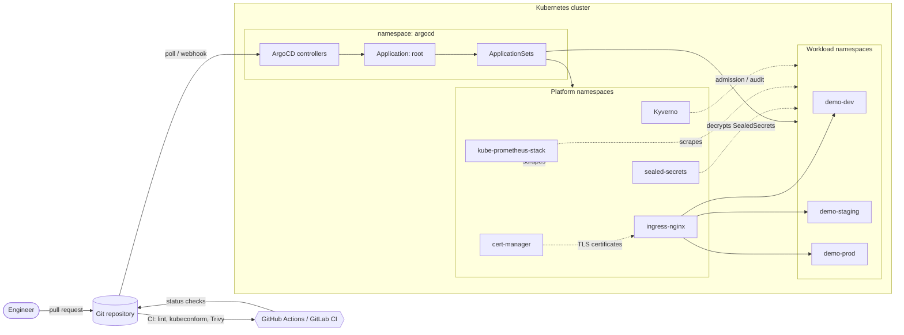
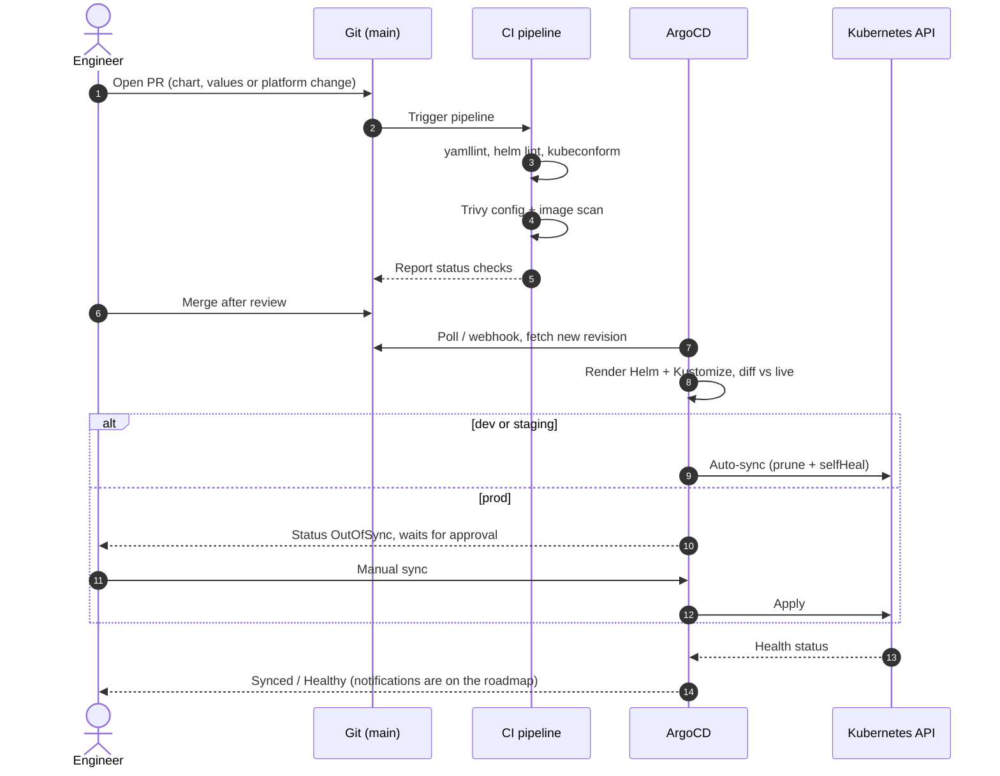
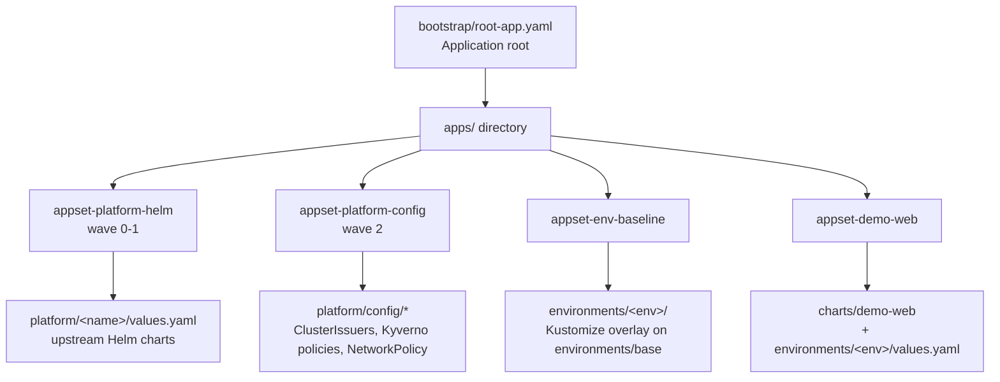
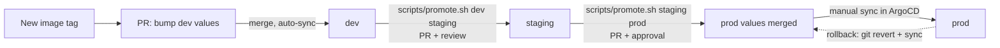

# GitOps Platform on Kubernetes

A multi-environment (dev / staging / prod) GitOps setup driven by **ArgoCD** using the **app-of-apps** and **ApplicationSet** patterns. One Git repository describes the cluster add-ons (ingress, certificates, secrets, monitoring, policy), the per-environment guardrails, and a hardened sample workload. Nothing is applied to the cluster by hand except a single root `Application`.

> **Status:** this is a reference/portfolio project. The manifests have been linted and partially validated offline, but **they have not been deployed to a live cluster**. See [Validation status](#validation-status) for exactly what was and was not checked.

Owner: Abdallah Elmalawany (DevOps engineer, CKA / CKS). Stack: RKE2-style production target, ArgoCD, Helm, Kustomize, Sealed Secrets, Vault (roadmap), cert-manager, Ingress NGINX, GitLab CI / GitHub Actions, Trivy, Prometheus + Grafana.

## Why

- **Git is the only source of truth.** Cluster state is reconciled from the repository, so every change is reviewed, versioned and revertible.
- **Environments are data, not copies.** One Helm chart and one `ApplicationSet` produce an `Application` per environment; the differences live in small values files and Kustomize overlays.
- **Security by default.** Restricted Pod Security, default-deny NetworkPolicy, non-root read-only containers, encrypted secrets in Git, Trivy and policy checks in CI.
- **Promotion is a pull request.** dev and staging sync automatically; prod requires a merged PR plus a manual sync.

## Features

| Area | What is included |
|------|------------------|
| Bootstrap | ArgoCD installed via Kustomize (pinned upstream manifest) or Helm values; `AppProject`s; a single root app |
| Patterns | App-of-apps (`root`) plus four `ApplicationSet`s (list, git-directory generators, `templatePatch`) |
| Workload | Helm chart `demo-web`: Deployment, Service, Ingress, HPA, NetworkPolicy, PDB, ServiceAccount, hardened `securityContext` |
| Environments | Per-env Helm values and Kustomize overlays (namespace with PSA `restricted`, ResourceQuota, LimitRange, default-deny) |
| Platform | ingress-nginx, cert-manager + ClusterIssuers, Sealed Secrets, kube-prometheus-stack, Kyverno policies (Audit mode) |
| CI | GitHub Actions and GitLab CI: yamllint, `helm lint`, `kubeconform`, Trivy config scan, Trivy image scan |
| DX | Makefile, kind config, helper scripts (bootstrap, validate, promote, seal-secret) |

## Architecture



### GitOps and CI/CD flow



### Repository layout and sync order



### Environment promotion



More detail: [docs/architecture.md](docs/architecture.md) and the decision records in [docs/decisions](docs/decisions).

## Prerequisites

- Docker, [kind](https://kind.sigs.k8s.io/) (or k3d), `kubectl` >= 1.30
- For linting/validation: `yamllint`, `helm` >= 3.14, `kubeconform`, optionally `trivy`
- A Git repository you can push to (ArgoCD pulls from it). Fork or copy this repo.
- Optional: `kubeseal` to work with Sealed Secrets

## Quick start (local kind cluster)

```bash
# 1. Point the manifests at YOUR repository (the committed URL is a placeholder)
scripts/set-repo-url.sh https://github.com/<you>/gitops-platform-argocd.git
git commit -am "Use my repo URL" && git push

# 2. Create the cluster (3 nodes, host ports 80/443 mapped for ingress)
make cluster

# 3. Install ArgoCD and apply the root app
make bootstrap

# 4. Open the UI
make argocd-password
make port-forward        # https://localhost:8080, user: admin
```

ArgoCD then creates the platform components, the three `demo-<env>` namespaces and the `demo-web-<env>` applications. To test ingress locally, add hosts to `/etc/hosts`:

```
127.0.0.1 demo.dev.example.com demo.staging.example.com demo.example.com grafana.example.com
```

Notes for a local run:
- The `dev` environment uses the `selfsigned` ClusterIssuer, so the browser will warn. The Let's Encrypt issuers need a public domain and are not usable on kind.
- `monitoring` expects a `grafana-admin` Secret in the `monitoring` namespace. Create it yourself (preferably as a SealedSecret) before the Grafana pod can start; no password is stored in this repo.
- Prod `demo-web-prod` shows `OutOfSync` until you sync it manually. That is intended.

## Security notes

- **No real secrets in Git.** `platform/sealed-secrets/examples/EXAMPLE-sealedsecret.yaml` contains placeholder ciphertext only and is not referenced by any Application. Use `scripts/seal-secret.sh` against your own cluster; back up the controller key outside Git.
- **Pod hardening:** `runAsNonRoot`, `readOnlyRootFilesystem`, all capabilities dropped, `seccompProfile: RuntimeDefault`, no ServiceAccount token automount.
- **Namespaces:** Pod Security Admission `restricted`, ResourceQuota, LimitRange, default-deny NetworkPolicy with explicit DNS and ingress-controller allow rules.
- **Policy:** Kyverno ClusterPolicies (non-root, no `:latest`, memory limits) ship in `Audit` mode; switch to `Enforce` after reviewing the reports.
- **ArgoCD:** workloads run in a restricted `AppProject` that can only target `demo-*` namespaces from this repository. Review and tighten RBAC and SSO before real use (the install here uses the built-in admin account).
- **Supply chain:** Trivy scans config and the demo image in CI. Pin GitHub Actions to commit SHAs and images to digests in a real deployment.
- **Chart/manifest versions** are pinned but were chosen without a live check; verify against upstream release notes before use.
- Domains are `example.com` placeholders and the ACME email is `platform-team@example.com`.

## Validation status

| Check | Result |
|-------|--------|
| `yamllint` on all non-templated YAML | Run locally |
| `kubectl kustomize` for `environments/{dev,staging,prod}` and `platform/config/*` | Run locally |
| `helm lint` / `helm template` / `kubeconform` | Configured in CI and `make validate`; **not run locally** (tools unavailable when the repo was created) |
| Trivy config / image scan | Configured in CI; **not run** |
| Deployment to kind / any cluster | **Not performed** |

## Project structure

```
.
|-- .github/workflows/ci.yml        # lint, kubeconform, Trivy (GitHub Actions)
|-- .gitlab-ci.yml                  # same pipeline for GitLab CI
|-- .yamllint.yaml
|-- Makefile
|-- bootstrap/
|   |-- argocd/                     # kustomization (pinned install), cmd-params patch, Helm values alternative
|   |-- projects.yaml               # AppProjects: platform, workloads
|   `-- root-app.yaml               # the only hand-applied Application
|-- apps/                           # reconciled by root (app-of-apps)
|   |-- appset-demo-web.yaml        # one Application per env (list generator)
|   |-- appset-env-baseline.yaml    # git directory generator over environments/*
|   |-- appset-platform-helm.yaml   # upstream charts + values from this repo (multi-source)
|   `-- appset-platform-config.yaml # git directory generator over platform/config/*
|-- charts/demo-web/                # hardened sample Helm chart
|-- environments/
|   |-- base/                       # namespace, quota, limit range, default-deny
|   `-- dev|staging|prod/           # kustomization overlay + Helm values.yaml
|-- platform/
|   |-- ingress-nginx|cert-manager|sealed-secrets|monitoring|kyverno/values.yaml
|   |-- sealed-secrets/examples/    # PLACEHOLDER SealedSecret (not synced)
|   `-- config/                     # cert-manager-issuers, kyverno-policies, network-defaults
|-- scripts/                        # create-cluster, bootstrap, validate, promote, seal-secret, set-repo-url
`-- docs/                           # architecture.md and decisions/ (ADRs)
```

## Roadmap

- [ ] Run end to end on a kind cluster and record the results here
- [ ] HashiCorp Vault with External Secrets Operator for dynamic secrets (see ADR 0002)
- [ ] ArgoCD SSO (OIDC), RBAC policies and Notifications (Slack / email)
- [ ] Argo Rollouts for canary releases in prod
- [ ] Automated image-tag bump PRs from the build pipeline
- [ ] Sign and verify images (cosign) with a Kyverno `verifyImages` policy
- [ ] Alert rules and Grafana dashboards for the demo workload
- [ ] RKE2 production profile (CIS hardening, etcd snapshots, multi-cluster ApplicationSet via cluster generator)

## License

MIT, see [LICENSE](LICENSE).
